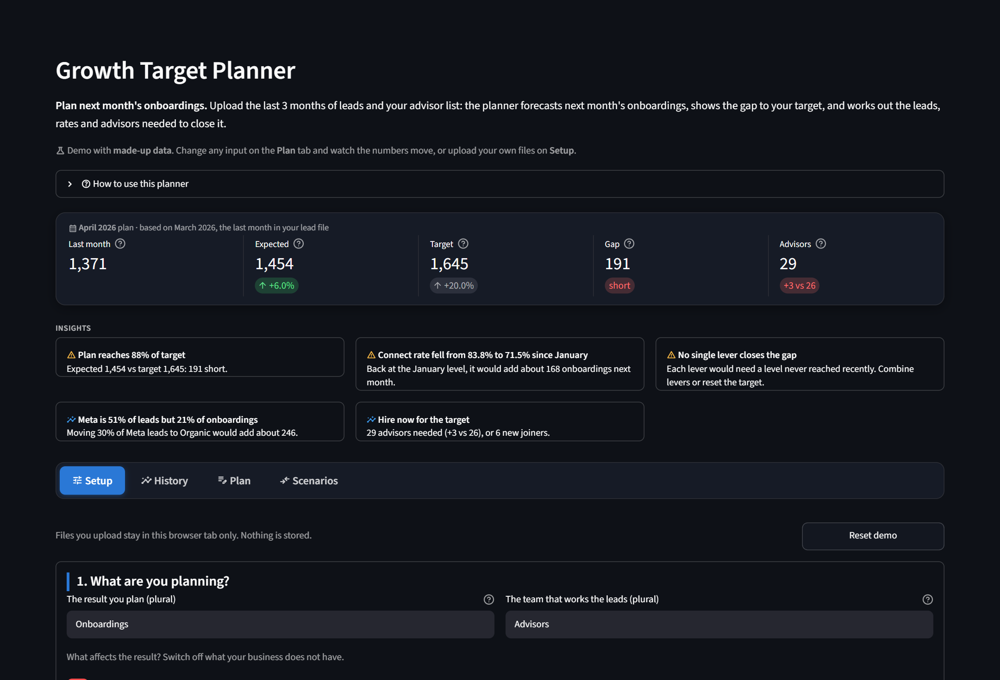
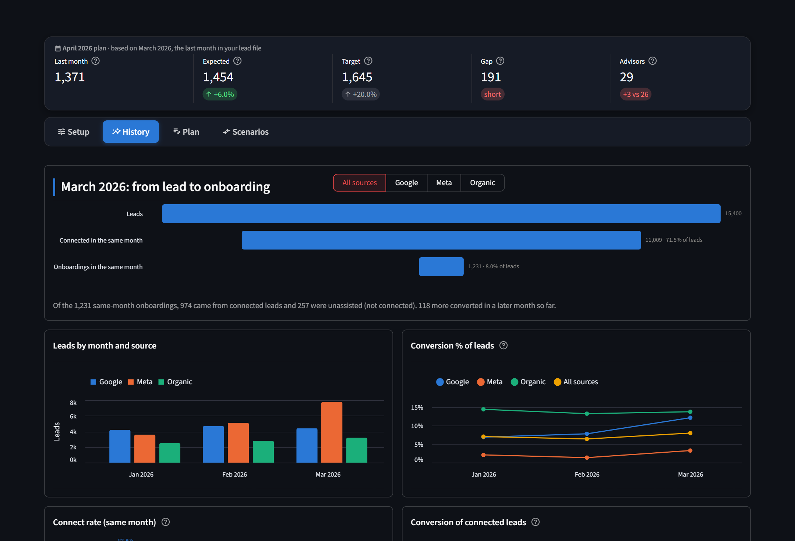
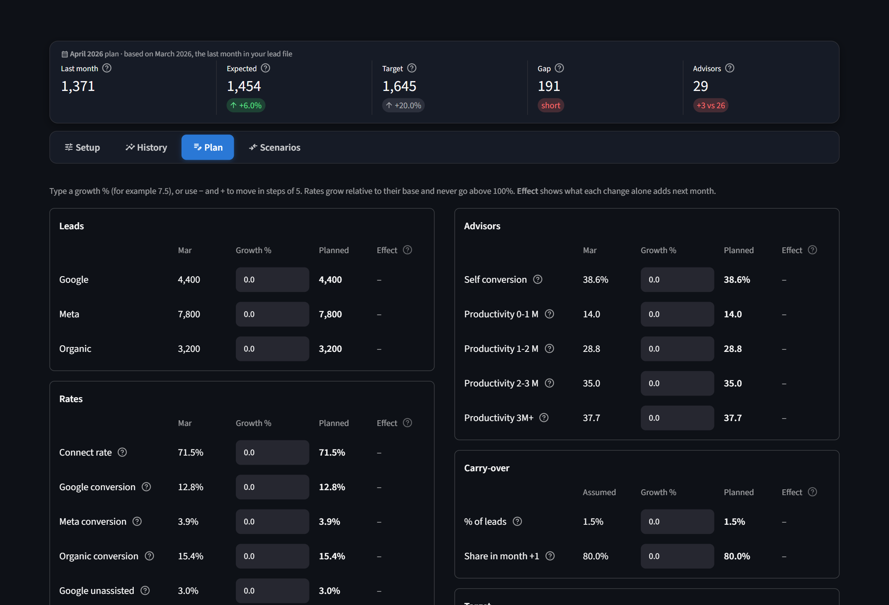
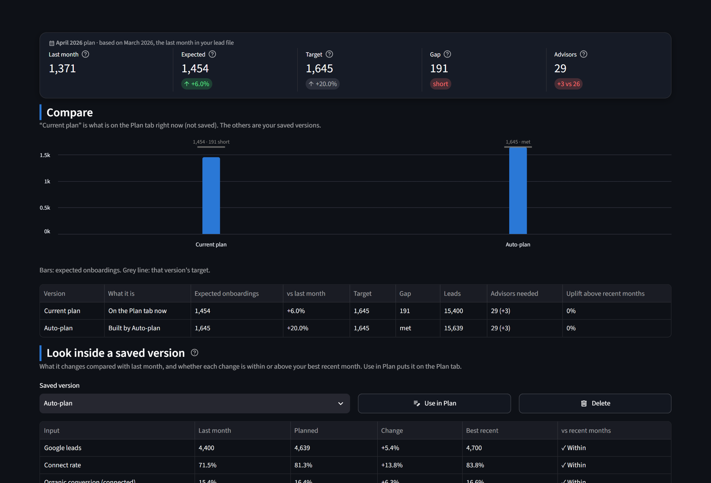
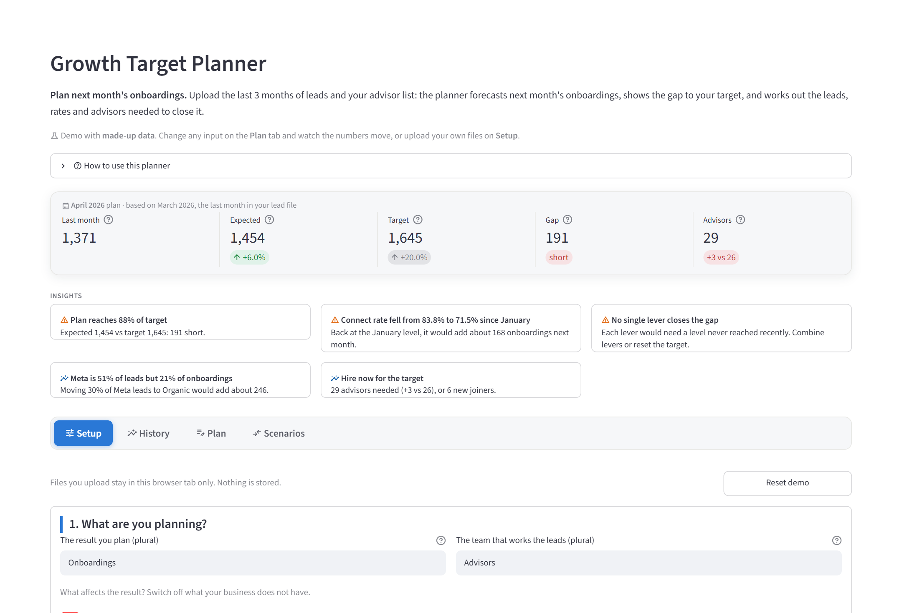
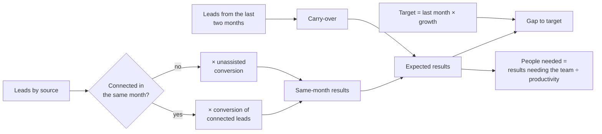

# Growth Target Planner

**Plan next month's onboardings.** An interactive planning tool for teams that turn leads into
onboardings (or enrolments, or sales). Upload the last three months of leads and your team list,
and it forecasts next month's onboardings, shows the gap to your target, and works out the leads,
rates and people needed to close it.

> **Live demo:** _add your Streamlit link here_
> · All data in this project is **made up** (see [`make_sample_data.py`](make_sample_data.py)).



---

## What it answers

1. **How many results will we get next month?** Built up lead source by lead source, from
   last month's actual rates.
2. **Will we hit the target, and if not, why?** A pinned KPI belt and a short leadership briefing:
   the gap, the rate that fell most recently and what recovering it is worth, the weakest lead
   source, and whether any single lever can close the gap within recent performance.
3. **What would it take?** Change any assumption and see its effect immediately, compare
   versions of the plan side by side, or let **Auto-plan** build a plan that reaches the target.
4. **How many people do we need?** Worked out from productivity by tenure band, for the forecast
   and for the target, including new hires.

## A quick tour

| | |
|---|---|
| **History**: last month's funnel (connected vs unassisted conversions) and the trends behind it: leads by source, conversion, connect rate, carry-over, productivity. |  |
| **Plan**: every input as *last month → growth % → planned*, with the **effect** of each change on its own. The belt at the top updates as you type. |  |
| **Scenarios**: save versions of the plan, compare them, and let **Auto-plan** move each lever back towards its best recent month until the target is reached. Each change is marked *within* or *above* recent performance. |  |

It follows light and dark mode automatically. In light mode:



## How the forecast works



```
same-month results = leads × (connect rate × conversion of connected leads
                              + unassisted conversion)            per source
carry-over         = last month's leads × carry-over % × month+1 share
                   + the month before's leads × carry-over % × (1 − month+1 share)
expected           = same-month results + carry-over
target             = last month's results × (1 + target growth)
people needed      = results that need the team ÷ average productivity of next month's team
```

- With last month's values, the model reproduces last month's results exactly.
- Next month's team is this month's team with everyone moved up one tenure band; the planner
  works out how many people are needed rather than asking for them.
- The plan always follows the last month in the lead file, so next month you upload the new
  three months and it plans the month after.

## Built for real use

- **Any funnel:** rename the result and the team (e.g. *Enrolments* and *Counsellors*) and switch
  steps off (connect step, team, carry-over) if a business doesn't have them.
- **Any export:** columns and values with clear names are matched automatically; anything unclear
  is asked with a dropdown. Each upload has a **Download a sample** button showing the layout. Plain-language data checks flag missing columns, unreadable dates,
  duplicates and more.
- **Editable without code:** settings live in [`config.yaml`](config.yaml) and the wording of
  every insight in [`suggestions.yaml`](suggestions.yaml).
- **Tested:** all calculations live in [`model.py`](model.py), separate from the screens, with
  pytest tests.

## Run it on your computer

```bash
python -m venv .venv
.venv\Scripts\python.exe -m pip install -r requirements.txt     # Mac/Linux: .venv/bin/python
.venv\Scripts\streamlit.exe run app.py                          # Mac/Linux: .venv/bin/streamlit
```

The made-up sample data loads automatically. Run the tests with
`.venv\Scripts\python.exe -m pytest`.

## Project structure

```
app.py               the screens (Streamlit)
model.py             all calculations and data checks (no screen code)
config.yaml          settings: names, funnel steps, tenure bands, matching rules
suggestions.yaml     wording of the leadership insights
make_sample_data.py  creates the made-up data in sample_data/
sample_data/         made-up lead file and team list
tests/               pytest tests
docs/images/         screenshots for this page
```

## Built with

Python · pandas · Streamlit · Altair · pytest
